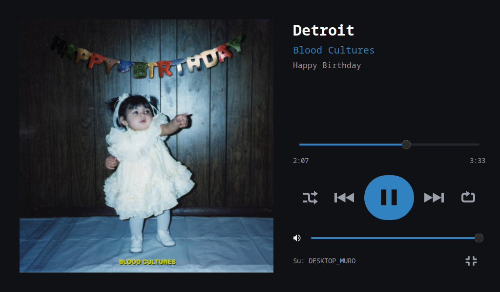

# obc40-desk-player

**Desk Player** turns the 1024×600 touch display of the **OBC40** board (HTE/Tecnint, NXP i.MX 8M Mini) running **Alpine Linux + XFCE** into a fullscreen **Spotify Connect remote**.

The board has no audio output: the music plays on another Spotify device (PC, phone, speakers) and Desk Player controls it through the Spotify Web API. **Spotify Premium is required.**



*Italiano: [vai alla sezione in italiano](#italiano).*

## Features

- **Now playing**: cover, title, artist (tap the artist to open their page), seek bar, play/pause, previous/next, shuffle, repeat, volume and current device. A ⛶ button opens a fullscreen view.
- **Library**: opens on **Recenti** (recently played): the albums and playlists you played, even if they are not saved, with the time of the last play, then the tracks. Then saved albums, followed artists, playlists and liked songs (loaded 100 at a time, then 50 more each time you reach the bottom).
- **Search** for tracks, artists, albums and your own playlists.
- **Queue**, with add (+) and remove (−).
- **Devices**: move playback to another device.
- **Artist pages**: releases with Album / Singles / EP filters.
- **Album and playlist pages**: year, track count and total length.
- **Sorting**: date added, release date, recently played or name, ascending or descending. Each page only offers the options that make sense for it.
- **List or card view**. Albums, playlists and the queue always use the list.
- **Accent colour** taken from the album cover, always readable on the dark background.
- Built for touch: no tooltips, no dashed focus rings, works with the onboard on-screen keyboard.
- The 🏠 button minimises Desk Player and shows whatever is behind it.

## Requirements

- An OBC40 running Alpine Linux with an XFCE session for a normal user. Python 3 with GTK 3: `apk add py3-gobject3 gtk+3.0`. Recommended: `papirus-icon-theme`, plus `font-noto-cjk` for Japanese, Chinese and Korean titles.
- Wi-Fi on the board, and SSH access to it from a PC for the one-time login.
- On the PC: Python 3 and the `ssh` client.
- A **Spotify Premium** account.

## Install

On the board, open a terminal **as the desktop user** (not root) and run **one line**:

```sh
wget -qO- https://raw.githubusercontent.com/dariotronic/obc40-desk-player/main/get.sh | sh -s -- --desktop-icon
```

[`get.sh`](get.sh) does the following:
1. checks the system packages and, if some are missing, offers to install them with `su` (it asks for the root password);
2. downloads the latest release and verifies its SHA-256 checksum;
3. runs `install.sh`;
4. starts the app.

Options:
- `--desktop-icon`: puts a "Musica" icon on the desktop;
- `--autostart`: opens Desk Player at every login.

Running it again reinstalls the latest version.

<details><summary>Manual install, step by step</summary>

```sh
cd /tmp
wget https://github.com/dariotronic/obc40-desk-player/releases/latest/download/obc40-desk-player.tar.gz
wget https://github.com/dariotronic/obc40-desk-player/releases/latest/download/obc40-desk-player.tar.gz.sha256
sha256sum -c obc40-desk-player.tar.gz.sha256
tar xzf obc40-desk-player.tar.gz
sh obc40-desk-player/install.sh --desktop-icon     # add --autostart to open it at every login
```
</details>

Then open **Musica** from the menu or the desktop.

## Connect your Spotify account (once)

1. **Create a Spotify app** at <https://developer.spotify.com/dashboard> → *Create app*:
   - **Redirect URI**: exactly `http://127.0.0.1:8888/callback`. Use `127.0.0.1`, not `localhost`.
   - **API**: tick **Web API**.
   - Copy the **Client ID**. Login uses PKCE, so no client secret is needed. The app can stay in development mode for personal use.
2. **On your PC**, with Desk Player open on the display, start the tunnel. Download [`login-tunnel.py`](https://raw.githubusercontent.com/dariotronic/obc40-desk-player/main/login-tunnel.py) from this repository:
   ```sh
   python login-tunnel.py <board-ip> --user <user> --key ~/.ssh/<private-key>
   ```
   The tunnel is needed because Alpine's sshd has `AllowTcpForwarding no`, so `ssh -L` does not work. The script forwards each connection with `ssh … nc 127.0.0.1 8888` instead.
3. Open <http://127.0.0.1:8888> in the PC browser, paste the Client ID, sign in and authorise the app. The display switches to the player by itself.
4. Close the tunnel with Ctrl+C.

The token renews automatically. It is stored in `~/.config/desk-player/auth.json` (mode 600). To sign out, use **Dispositivi → Esci dall'account**.

## Updating

Go to **Dispositivi** (Devices) and tap **Controlla aggiornamenti** ("Check for updates"). If a newer release exists you see what changed and can tap **Aggiorna** ("Update"). The app then:

1. downloads the release package;
2. verifies its SHA-256 checksum;
3. installs it, keeping the current version as `.prev`;
4. restarts.

If the new version fails to start within 20 seconds, the previous one is restored automatically. Nothing is ever updated without you tapping the button.

## Known limits

These come from the Spotify Web API or the platform. They are not bugs to fix.

| What | How Desk Player handles it |
|---|---|
| Playing a list of `uris` returns 204 but nothing plays, at least on the desktop client | Every track starts inside a **context** with an offset: its album, or your Liked Songs collection |
| Tracks of playlists owned by **other users** return 403, even if you follow them: the API only serves playlists you own or collaborate on | Search only shows your own playlists. Opening someone else's playlist shows a message; ▶ still tries to play it |
| Saving or removing liked songs with `PUT/DELETE me/tracks` returns 403, and those endpoints are now deprecated | No "like" button yet |
| The API cannot remove tracks from the queue | A removed track is hidden and skipped when it starts, as long as the app is running |
| Spotify limits how many requests an app can make (HTTP 429) | Desk Player waits as long as Spotify asks (`Retry-After`), checks the player less often when nothing plays, and not at all while minimised |
| "Recently played" only covers the last 50 plays | Items without data go to the bottom |
| Followed playlists and artists have no dates | Those pages offer no date-based sorting |
| On the 4.14 kernel, recent musl and GLib use `faccessat2` (kernel 5.8 or newer), so GLib file checks always fail | The wrapper preloads [`faccessat-fix`](faccessat-fix/) |

## Uninstall

```sh
rm -rf ~/.local/share/obc40-desk-player ~/.local/share/obc40-desk-player.prev ~/.local/bin/desk-player \
       ~/.local/share/applications/desk-player.desktop ~/.config/autostart/desk-player.desktop ~/Desktop/desk-player.desktop
rm -rf ~/.config/desk-player     # login and settings
```

## Development

The code is plain Python 3 + GTK 3 with no build step.

| File | What |
|---|---|
| `desk-player` | the app |
| `obc_update.py` | the in-app updater (GitHub Releases) |
| `login-tunnel.py` | runs on the PC |
| `dev/` | test helpers to run on the board |
| `docs/spotify-api.md` | rules for working with the Spotify Web API: read it before changing API calls |

The `dev/` helpers:
- `env.sh` attaches an SSH shell to the graphical session.
- `dpnav.sh <section>` opens a section through D-Bus and takes a screenshot; `dpcall.sh <action>` does the same without the screenshot.
- `uitool.py tap X Y` simulates taps.

The D-Bus actions are:
- the sections `library`, `search`, `queue`, `devices`, `liked`, `recent`;
- `full`, `open:<playlist|album|artist>:<id>`, `current-artist`, `sort-dialog`, `liked-more`, `focus-info`;
- `accent:<cover-url|default|fade-on|fade-off|bench>`;
- `check-updates`, as a separate action.

To try a change on the board, copy the edited file over the installed one and restart the app:

```sh
scp desk-player <user>@<board>:.local/share/obc40-desk-player/desk-player
```

`dev/` is only in the git repository, not in the release package: copy it to the board if you need it.

### Branches

| Branch | What |
|---|---|
| `develop` | default branch, where the work happens. Pull requests go here. For longer work, use a `feature/<name>` branch off `develop` and merge it back with a pull request. |
| `main` | only released code, the same code boards get through the updater and `get.sh`. It changes only through a pull request from `develop`. |

Both branches are protected against deletion and force pushes.

### Releasing (maintainers)

1. On `develop`: bump `VERSION` and add a `## x.y.z` section at the top of `CHANGELOG.md`. That section becomes the release notes the user sees on the board. Commit and push.
2. Open a pull request from `develop` to `main` and merge it:
   ```sh
   gh pr create --base main --head develop --title "Release vx.y.z" --body "See CHANGELOG.md"
   gh pr merge --merge
   ```
3. `git checkout main && git pull`, then run `python tools/build_release.py`. It refuses to run outside an up-to-date `main` or for a version that already has a tag. It builds `dist/obc40-desk-player.tar.gz` and its `.sha256`, then prints the `git tag` and `gh release create` commands to run.
4. Bring `develop` level with `main`: `git checkout develop && git merge main && git push`.

The updater always takes the **latest release**: publish one only when it is ready for every board.

## Contributing

Issues and pull requests are welcome. Only the maintainers can push to this repository and publish releases.

## License

[MIT](LICENSE)

---

## Italiano

**Desk Player** trasforma il display touch 1024×600 della **OBC40** con **Alpine Linux e XFCE** in un telecomando Spotify a schermo intero. La musica suona su un altro dispositivo Spotify (PC, telefono, casse). **Serve Spotify Premium.**

**Installazione**: sulla scheda apri un terminale **con l'utente del desktop** (non root) e scrivi **una riga**:

```sh
wget -qO- https://raw.githubusercontent.com/dariotronic/obc40-desk-player/main/get.sh | sh -s -- --desktop-icon
```

Lo script controlla i pacchetti di sistema e, se ne manca qualcuno, si offre di installarli chiedendo la password di root. Poi scarica l'ultima versione, ne verifica il checksum, la installa e avvia l'app.

**Login Spotify** (una volta sola):
1. Crea un'app su <https://developer.spotify.com/dashboard>:
   - Redirect URI **`http://127.0.0.1:8888/callback`**;
   - spunta **Web API**;
   - copia il **Client ID**.
2. Dal PC, con Desk Player aperto sul display, lancia:
   ```sh
   python login-tunnel.py <ip-scheda> --user <utente>
   ```
3. Apri <http://127.0.0.1:8888> nel browser del PC e incolla il Client ID.

**Aggiornamenti**: **Dispositivi → Controlla aggiornamenti**. Se c'è una versione nuova vedi le novità e puoi toccare **Aggiorna**. L'app scarica il pacchetto, ne verifica il checksum, lo installa e si riavvia. Se la nuova versione non parte, torna da sola a quella precedente. Gli aggiornamenti partono solo quando tocchi il pulsante.

**Limiti noti**: sono dell'API di Spotify, vedi la tabella [Known limits](#known-limits).
- Le playlist di altri utenti non mostrano i brani.
- Il "mi piace" non è disponibile.
- I brani rimossi dalla coda vengono saltati.
- "Ascoltato" considera solo gli ultimi 50 ascolti.

**Per chi sviluppa**: vedi [Development](#development) e [Releasing](#releasing-maintainers). Le release le pubblicano solo i maintainer.
